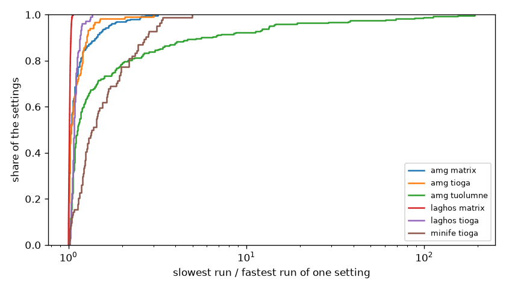

# Check how repeatable the runs are

You'll measure two kinds of spread in the sweep, between the processes of one run and between the runs of one setting.
It takes about 10 minutes of your time on a compute node.

## Before you start

Start Python on a compute node and open the full sweep, as in [Measure the flop rate as processes share a node](06-flop-rate-as-processes-share-a-node.md).

```python
from dftracer.utils import Indexer, TraceViewer, col

TRACE = "/usr/workspace/genesis-wisdom/dftracer-traces/genesis-sweep/genesis.pfw.gz"
INDEX = "data/full-index"
with Indexer(files=[TRACE], index_dir=INDEX) as ix:
    ix.ensure_indexed()
    runs = ix.rowset("runs")
tv = TraceViewer(TRACE, INDEX)
print(runs.shape)
```

```text
(9624, 10)
```

```python
import os

import matplotlib.pyplot as plt

os.makedirs("figures", exist_ok=True)
main = tv.filter((col("gtype") == "func") & (col("path") == "main")).collect().merge(runs, on="run")
main = main.assign(t=main["dur.p50"] / 1e6)
```

## 1. Spread between the processes of one run

Each process calls `main` once, so `dur.p50` and `dur.p99` of `main` are the median and the slowest processes.
Their ratio is 1 when all processes take the same time.

```python
main = main.assign(spread=main["dur.p99"] / main["dur.p50"])
print(main.groupby(["app", "system"])[["spread"]].quantile(0.99))
```

```text
      app    system    spread
0     amg    matrix  2.588356
1     amg     tioga  1.158101
2     amg  tuolumne  1.142324
3  laghos    matrix  1.001153
4  laghos     tioga  1.045043
5  minife     tioga  1.521983
6  minife  tuolumne  1.055714
```

For 99% of the runs of laghos, and of amg on tioga and tuolumne, the slowest process is within about 16% of the median one.
amg on matrix and minife on tioga have runs where it is 1.5 to 2.6 times slower.

## 2. Spread between the runs of one setting

A setting ran once for each counter set, so it has 2 to 9 runs.
They are the same program with the same input, so they should take about the same time.

```python
setting = ["app", "system", "unique_input", "nodes", "ppn"]
g = main.groupby(setting)[["t"]]
rep = g.min().rename(columns={"t": "fastest"}).merge(g.max().rename(columns={"t": "slowest"}), on=setting)
rep = rep.assign(ratio=rep["slowest"] / rep["fastest"])
print(rep.groupby(["app", "system"])[["ratio"]].median())
print(rep.nlargest(5, "ratio"))
```

```text
      app    system     ratio
0     amg    matrix  1.033971
1     amg     tioga  1.031321
2     amg  tuolumne  1.125494
3  laghos    matrix  1.012806
4  laghos     tioga  1.074222
5  minife     tioga  1.363507
6  minife  tuolumne  1.934835
   app    system  unique_input  nodes  ppn   fastest    slowest       ratio
0  amg  tuolumne   p1_n16x16x8      4   16  0.181762  34.988555  192.496481
1  amg  tuolumne   p1_n16x16x8      4   32  0.276639  42.739568  154.495970
2  amg  tuolumne   p1_n16x16x8      8   32  0.331199  37.162858  112.207146
3  amg  tuolumne   p1_n16x16x8      8   16  0.240497  23.809172   98.999858
4  amg  tuolumne   p1_n16x16x8      4    4  0.069593   6.135249   88.158782
```

```python
r = rep.to_pandas()
fig, ax = plt.subplots(figsize=(7, 4))
for (app, system), rows in r.groupby(["app", "system"]):
    if len(rows) > 20:
        ax.ecdf(rows["ratio"], label=f"{app} {system}")
ax.set_xscale("log")
ax.set_xlabel("slowest run / fastest run of one setting")
ax.set_ylabel("share of the settings")
ax.legend(fontsize=8)
fig.tight_layout()
fig.savefig("figures/run-to-run.png", dpi=120)
```



For amg on matrix and tioga and for laghos, the runs of one setting are within a few percent of each other in the median.
minife differs more, by about 36% on tioga.
On tuolumne a few amg settings have runs that are up to 192 times slower than the fastest one.

## 3. Look at one slow setting

```python
worst = rep.nlargest(1, "ratio").to_pandas().iloc[0]
same = main[
    (main["app"] == worst["app"])
    & (main["system"] == worst["system"])
    & (main["unique_input"] == worst["unique_input"])
    & (main["nodes"] == worst["nodes"])
    & (main["ppn"] == worst["ppn"])
]
print(same[["run", "papi_set", "t"]].sort_values("t"))
```

```text
                run                                                                             papi_set          t
0  1efda4c3a3d4dd3c                                                              PAPI_TLB_DM+PAPI_TLB_IM   0.181762
1  502cc871390f4391                                                            PAPI_FDV_INS+PAPI_FSQ_INS   0.181762
2  e1b0909ae12b40fc                                                PAPI_FMA_INS+PAPI_FP_INS+PAPI_VEC_INS   0.181762
3  8308fd4fe7bf0e2d                                                            PAPI_FAD_INS+PAPI_FML_INS   0.185434
4  de7096aebf86d842                                                            PAPI_TOT_CYC+PAPI_TOT_INS   0.189180
5  487e20fbcde2426f  PAPI_L1_DCA+PAPI_L1_DCM+PAPI_L2_DCH+PAPI_L2_DCM+PAPI_L2_DCR+PAPI_L2_ICM+PAPI_L2_TCM   0.192762
6  f4ea39c86b3b0873                                      PAPI_L2_ICA+PAPI_L2_ICH+PAPI_L2_ICR+PAPI_L2_TCH   0.193002
7  5912c9b05e7abb62   PAPI_BR_CN+PAPI_BR_INS+PAPI_BR_MSP+PAPI_BR_NTK+PAPI_BR_PRC+PAPI_BR_TKN+PAPI_BR_UCN  34.290002
8  c386cb27d77f9c1e                                                                          PAPI_FP_OPS  34.988555
```

Over all such settings the slow runs come from at least five different counter sets, so no one counter set makes them slow.
[Read the host counters of each run](12-host-counters.md) shows that the host CPU counters don't explain them either.

## What you built

You measured the spread between processes and between runs, and found the settings whose runs disagree.

- Next: [Read merged distributions](10-merged-distributions.md)
